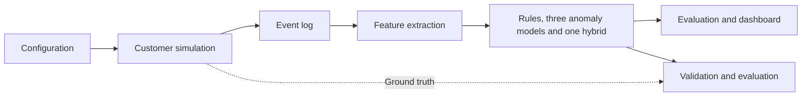

# 5 Methodology

## 5.1 Research approach and design

This study used a pragmatic epistemological stance and a quantitative approach to investigate whether behavioural risk scoring could identify cardless withdrawal vouchers associated with social-engineering scams. The emphasis on a practical problem was consistent with pragmatism's focus on actionable knowledge ([Kelly and Cordeiro, 2020](https://doi.org/10.1177/2059799120937242)). A scoring prototype was developed and evaluated through a controlled computational experiment, following the design science approach of building and assessing an artefact ([vom Brocke, Hevner and Maedche, 2020](https://doi.org/10.1007/978-3-030-46781-4_1)). The experiment compared rule-based, anomaly-based and hybrid methods using the same simulated activity.

## 5.2 Research process

The process followed the pipeline in Figure 5.1: configuration, customer simulation, event logging, feature extraction, scoring and evaluation. Python, NumPy and pandas supported data generation and processing; scikit-learn provided the models; Matplotlib produced the plots; and Streamlit provided the dashboard. The main simulator seed was 42 and the model seed was 0. Three notebooks covered data checks and EDA, model fitting and validation, and test results with dashboard export. Reusable Python modules supplied the simulator, feature extractor and scoring functions. The configuration, seeds and software versions were retained to support repeatability within a consistent environment.

Ground truth was excluded from anomaly-model fitting but used for validation-based selection and evaluation. Its additional use during dataset development is acknowledged in Section 5.10.

*Figure 5.1: Research pipeline. Ground truth supports validation and evaluation and is excluded from anomaly-model fitting.*

## 5.3 Synthetic dataset

A seeded, rule-based simulator generated customer banking activity because real customer transaction data was unavailable. It represented individual customers over 180 days, from 1 July to 27 December 2025, allowing behavioural features to be calculated from their earlier activity. The simulator generated the records directly; no learned generator or language model produced the banking rows.

### Customer activity

The simulator created 20,000 customers across four segments, using the starting settings in Table 5.1. Each customer's activity rate and typical amount varied around the segment values. Customers also received a home location, account opening date, preferred activity hour and recurring recipients. These population and behavioural settings were simulation assumptions rather than estimates from bank records.

| **Segment** | **Share** | **Monthly rate** | **Typical amount** |
|---|---|---|---|
| Student | 20% | 0.5 | R300 |
| Salaried | 45% | 0.8 | R800 |
| Informal income | 20% | 1.2 | R600 |
| Pensioner | 15% | 0.4 | R500 |

*Table 5.1: Starting customer segment settings.*

Daily voucher sessions were sampled from each customer's activity rate, with increases around payday, weekends and December. Amounts and session times varied around personal habits. Recipients could be recurring contacts, new recipients or the customer themselves. Background sessions included account activity without voucher creation, while legitimate vouchers could be redeemed quickly or remain unredeemed.

Three legitimate unusual episodes were added: emergencies, new-phone use and travel. These could produce large amounts, recent account changes or distant cash-outs, creating overlap with scam indicators. This prevented the dataset from treating every unusual action as fraud.

### Product settings

The generic product used a R2,500 default daily limit, raisable to R5,000, following Nedbank's published FAQ ([Nedbank, n.d.](https://www.nedbank.co.za/content/dam/nedbank/site-assets/Personal/Digital/Toolsandguidance/FAQs%20-%20Nedbank%20Cardless%20Withdrawal%2010%20March%202022.pdf), question 7). A R25,000 monthly sending limit, R50 increments with additional R100 rounding, and 30-day validity were informed by Absa's CashSend instructions ([Absa, n.d.](https://www.absa.co.za/help/how-to-make-payments/)). The simulator enforced sending limits and represented full-amount redemption at an ATM or retailer. These settings combined product characteristics rather than reproducing one bank's complete service or PIN-verification process.

### Scam scenarios and validation

Five scam scenarios were implemented: classic, self-send, limit raise, split vouchers and subtle. Classic scams combined possible new-recipient, high-amount and fast-redemption indicators. Self-send scams represented instructions to create a voucher for the customer's own number and disclose its details, as described by Standard Bank ([Standard Bank, n.d.](https://www.standardbank.co.za/southafrica/personal/products-and-services/security-centre/bank-safely/scams)). Limit-raise scams requested an increased limit; split scams attempted several vouchers in one session; and subtle scams used less pronounced indicators. SABRIC's report provided the wider social-engineering context ([SABRIC, 2025](https://www.sabric.co.za/wp-content/uploads/2025/09/CRIME-STATISTICS-REPORT-2024.pdf)). Numerical scenario probabilities were researcher-set assumptions, with flags sampled according to each scenario. Scam episodes were introduced from day 30 onwards.

A voucher was labelled scam if it originated in a scam episode, and legitimate otherwise. Scenario and episode identifiers supported later analysis. Labels were stored separately and joined after feature extraction. Checks examined amount and limit constraints, redemption timing, missing labels and history consistency. The revised EDA compared voucher amounts, cash-out delays and three warning indicators using percentages within each class. Class comparisons used records before the test boundary; overall counts described the full dataset. The resulting dataset contained 216,147 vouchers from 19,078 active customers, including 2,761 scam vouchers. Detailed validation and EDA findings are reported in the Discussion.

## 5.4 Scoring points and prediction task

The unit of analysis was one voucher, scored at two points. Stage A used information available at creation, including amount, recipient, session and earlier account activity. Stage B scored redeemed vouchers using the stored Stage A features plus redemption delay, location and channel. These represented possible intervention points at creation and cash-out; the prototype itself did not execute payment holds.

Events were replayed chronologically for each customer. Creation features were calculated before adding the current voucher to history, and redemption features used earlier cash-outs before updating the profile. Stage B retained the creation-time values of Stage A features rather than recalculating them at cash-out.

## 5.5 Feature engineering

Features described the current voucher and its relationship to earlier customer activity. Rolling counts and sending totals followed the transaction-aggregation approach described in the fraud detection handbook by [Le Borgne et al. (2022)](https://fraud-detection-handbook.github.io/fraud-detection-handbook/Chapter_3_GettingStarted/Introduction.html). The extractor produced 34 fields, grouped in Table 5.2. Models were fitted across customers using these behavioural summaries.

| **Group** | **Count** | **Examples** |
|---|---|---|
| Amount | 4 | Amount; ratio to 90-day average or daily limit |
| History and velocity | 7 | Earlier vouchers; 24-hour and session counts |
| Recipient | 3 | Previously used recipient; self-send |
| Session | 2 | Time since login; screens viewed |
| Timing | 5 | Deviation from usual hour; night indicator |
| Account changes and age | 6 | Limit, device and password changes; account age |
| Redemption | 7 | Delay; distance from usual area; cash-out channel |
| **Total** | **34** | 27 creation fields and seven redemption fields |

*Table 5.2: Extracted feature groups.*

Amount comparisons used the preceding 90-day mean and largest earlier voucher. Velocity features used 24-hour, seven-day and session windows. Usual creation time used a circular mean, while the usual cash-out location was the centroid of earlier redemptions, falling back to home when unavailable. With no history, amount ratios started at 1 and voucher counts at zero. Time-since-event features used a 365-day default and cap.

Six contextual or duplicate fields were excluded: the history indicator, raw creation hour, day of week, payday indicator, raw redemption hour and redeemed indicator. This left 23 Stage A and 28 Stage B model inputs. LOF and One-Class SVM also omitted amount-to-limit ratio and recipient-added-in-session because of redundancy with amount and recipient-known status, leaving 21 and 26 inputs.

Selected amount, ratio, duration and distance inputs used log(1 + x) transformations. LOF and One-Class SVM were also standardised using fitting-period parameters. Isolation Forest used the transformed inputs without standardisation. Identifiers, scenario names and scam labels were excluded from model inputs.

## 5.6 Risk scoring methods

### Rules and anomaly models

The baseline summed 13 weighted rules, with 11 available at creation and two added at redemption. Creation rules covered recipient novelty, unusual or near-limit amounts, recent limit or device changes, first use, voucher velocity, long sessions and night-time activity. Redemption rules flagged cash-out in less than 15 minutes and at least 50 km from the usual area. Weights were hand-set and the total capped at 100. For example, a new recipient added 20 points and an amount at least 80% of the daily limit added 15. Rule-score bands were Low (0--39), Medium (40--69), High (70--89) and Critical (90--100), with explanations for each triggered rule.

Three anomaly models represented isolation, local-density and boundary approaches, as reviewed by [Ruff et al. (2021)](https://doi.org/10.1109/JPROC.2021.3052449). Table 5.3 summarises their implementation. Each was fitted without labels on the mixed fitting data, including any scams present.

| **Model** | **Implementation** |
|---|---|
| Isolation Forest | 300 trees; up to 256 fitting observations per tree |
| LOF | Novelty mode; up to 20,000 sampled fitting rows |
| One-Class SVM | RBF kernel; up to 10,000 sampled fitting rows |

*Table 5.3: Anomaly model settings.*

### Hybrid scores

Anomaly scores were oriented so higher meant more unusual, then converted to empirical percentiles against all eligible fitting rows. A percentile indicated relative abnormality, rather than the probability of a scam. At each stage, the anomaly model with the highest validation F1 was combined with the rule score using an equal blend:
\[
H = 0.5\left(\frac{R}{100}\right)+0.5A,
\]
where \(R\) is the capped rule score and \(A\) the anomaly percentile. The equal weight was fixed for this revised experiment. This produced five approaches per stage: rules, Isolation Forest, LOF, One-Class SVM and one hybrid.

## 5.7 Experimental design and evaluation

The observation period was divided into 90 fitting days, 30 validation days and 60 test days (Table 5.4). Stage A used creation time and Stage B used cash-out time to assign records. A cash-out occurring after a boundary therefore entered the later period. Customer histories continued to update from preceding events, while model parameters and standardisation remained fixed during testing. Stage B included only redeemed vouchers, so the stages had different evaluation populations.

| **Period** | **Days** | **Stage A** | **Stage B** |
|---|---|---|---|
| Fitting | 0--89 | 97,452 | 94,152 |
| Validation | 90--119 | 34,748 | 33,862 |
| Test | 120--179 | 83,947 | 81,208 |

*Table 5.4: Voucher counts by period and stage. Stage A uses creation time; Stage B uses cash-out time.*

LOF's neighbourhood size was selected from 20, 50, 100 and 200, and One-Class SVM's nu from 0.01, 0.05, 0.1 and 0.2. For each candidate, the threshold giving the highest validation F1 was identified, and the candidate with the highest resulting F1 was retained. Threshold ties favoured the higher threshold; model-setting ties retained the first listed setting. The best validation anomaly model was used for the hybrid, whose threshold was selected in the same way. These choices were saved before scoring the test period. Test labels were used to calculate results, rather than select the settings or thresholds.

Evaluation used precision, recall, F1 and false positive rate, calculated from the confusion-matrix counts with scam as the positive class ([Le Borgne et al., 2022](https://fraud-detection-handbook.github.io/fraud-detection-handbook/Chapter_4_PerformanceMetrics/ThresholdBased.html)). Precision measured the share of alerts that were scams; recall measured the share of scams detected; F1 balanced precision and recall; and false positive rate measured the share of legitimate vouchers flagged. Reporting these measures avoided relying on overall accuracy, which could be high simply because most vouchers were legitimate.

The results included scams caught and missed, legitimate vouchers flagged and left unflagged, and alert rates within each scenario. Scenario breakdowns helped distinguish scam detection from false alarms on legitimate emergencies, new-phone use and travel. The comparison described the fixed synthetic experiment without confidence-interval or statistical-significance claims.

## 5.8 Prototype dashboard

A Streamlit dashboard presented an alert queue ranked by risk, a customer history view and model performance summaries. It used the saved equal-weight hybrid scores and stage-specific anomaly model selected in validation, with an optional ground-truth view for evaluation. Hybrid bands reused validation cutoffs: Medium targeted 80% recall, High used the selected alert threshold, and Critical targeted 70% precision, subject to ordered boundaries. High and Critical therefore matched the evaluation alert decision; the targets were not guarantees of test performance. Date filtering used the relevant scoring time. These differed from the fixed rule-score bands. The dashboard demonstrated historical replay and suggested handling of alerts; it did not connect to a bank or execute interventions.

## 5.9 Ethics and use of generative AI

The experiment used simulated customers and transactions, with public product descriptions and scam warnings informing the design. No real customer banking records were processed. Any required institutional ethics clearance or exemption must be recorded before submission. Generative AI assisted with drafting and editing this methodology; the final declaration should also record actual assistance during implementation and other report writing. The banking rows themselves were generated by the seeded simulator.

## 5.10 Methodological limitations

Findings describe relative performance within the simulation, whose customer behaviour, scam probabilities and rule weights depended on assumptions. Labels were excluded from anomaly fitting but used for tuning and class-based dataset development, including generator revisions informed by EDA and the diagnostic tree. The complete research process was therefore not label-free, and the test period was not established as untouched throughout development.

Stage B excluded unredeemed vouchers and used cash-out times, while Stage A used creation times. The stages therefore differed in both information and eligible records; performance differences cannot be attributed solely to adding redemption features. The study evaluated detection and alerts, rather than operational latency, customer responses or financial losses prevented.

## References

Absa. (n.d.). *Online banking -- how to make payments*. [CashSend instructions](https://www.absa.co.za/help/how-to-make-payments/) (Accessed: 20 October 2026).

Kelly, L.M. and Cordeiro, M. (2020). Three principles of pragmatism for research on organizational processes. *Methodological Innovations*, 13(2). [https://doi.org/10.1177/2059799120937242](https://doi.org/10.1177/2059799120937242).

Le Borgne, Y.-A., Siblini, W., Lebichot, B. and Bontempi, G. (2022). *Reproducible Machine Learning for Credit Card Fraud Detection -- Practical Handbook*. Université Libre de Bruxelles. [Online handbook](https://fraud-detection-handbook.github.io/fraud-detection-handbook/).

Nedbank. (n.d.). *Nedbank cardless withdrawals*. FAQ, version identified in its URL as 10 March 2022. [Official FAQ](https://www.nedbank.co.za/content/dam/nedbank/site-assets/Personal/Digital/Toolsandguidance/FAQs%20-%20Nedbank%20Cardless%20Withdrawal%2010%20March%202022.pdf) (Accessed: 20 October 2026).

Ruff, L., Kauffmann, J.R., Vandermeulen, R.A., Montavon, G., Samek, W., Kloft, M., Dietterich, T.G. and Müller, K.-R. (2021). A unifying review of deep and shallow anomaly detection. *Proceedings of the IEEE*, 109(5), pp. 762--795. [https://doi.org/10.1109/JPROC.2021.3052449](https://doi.org/10.1109/JPROC.2021.3052449).

SABRIC. (2025). *Annual Crime Statistics 2024*. South African Banking Risk Information Centre. [Report](https://www.sabric.co.za/wp-content/uploads/2025/09/CRIME-STATISTICS-REPORT-2024.pdf).

Standard Bank. (n.d.). *Types of scams and bank fraud*. [Instant Money scam warnings](https://www.standardbank.co.za/southafrica/personal/products-and-services/security-centre/bank-safely/scams) (Accessed: 20 October 2026).

vom Brocke, J., Hevner, A. and Maedche, A. (2020). Introduction to design science research. In: J. vom Brocke, A. Hevner and A. Maedche (eds), *Design Science Research. Cases*. Springer, pp. 1--13. [https://doi.org/10.1007/978-3-030-46781-4_1](https://doi.org/10.1007/978-3-030-46781-4_1).
